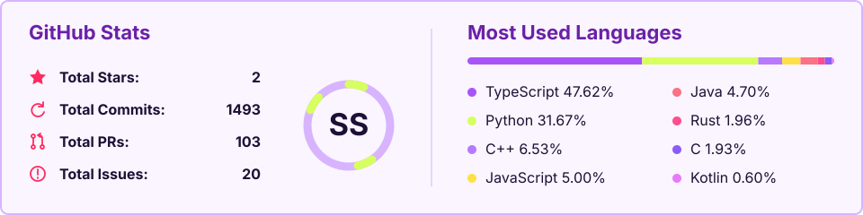
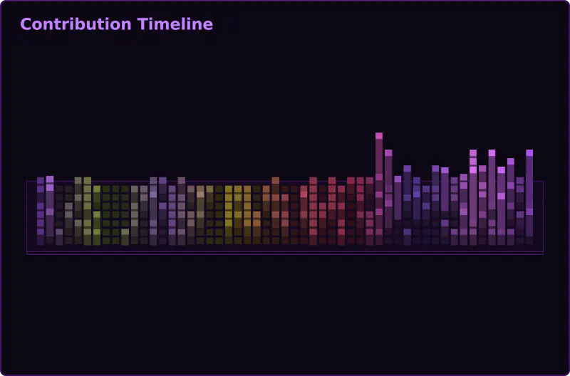

<!-- profile-banner:header -->

<!-- /profile-banner:header -->

 

## GO Horse Developer · Rust Script Kiddie · Absolute Fullstack

Highly hyperbolic, addicted to Warhammer and to drawing tsunderes. I'm hard-headed, a clown, a tortoise dad, a Yuri romance writer and an EX Emo. I'm currently a fullstack dev on an LG project focused on process automation and Agents. When it comes to studying, I like to mix a lot of things up; right now I'm reading _Hands-On Machine Learning_ and a bit of _Designing Data-Intensive Applications_. Drop me a message and let's swap notes.

## Stacks

#### Agents & Generative AI

#### Machine Learning

#### Backend & Database

#### Frontend

#### DevOps & Engineering

#### Testing & Observability

## GitHub Stats

<picture>
  <source media="(prefers-color-scheme: dark)" srcset="assets/github-overview-dark.svg" />
  <source media="(prefers-color-scheme: light)" srcset="assets/github-overview-light.svg" />
  
</picture>

 

 

<!-- profile-banner:footer -->

<!-- /profile-banner:footer -->
